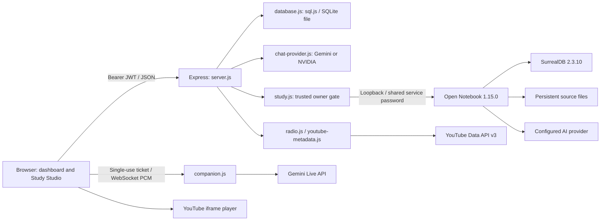

# ZUNO architecture

Inventory reviewed 27 October 2026. This repository is a CommonJS Node application with a vanilla HTML/CSS/JavaScript frontend. It has no React application, ORM, Redis, separate cache server, or frontend compilation pipeline. `package-lock.json` is the dependency version authority; install with `npm ci`.

## Components and data flow

`server.js` loads environment configuration, validates the JWT secret, installs HTTP security middleware, serves an explicit list of HTML entry points and `/assets`, attaches APIs, initializes SQLite, and starts HTTP/WebSocket service. `security.js` supplies secret validation and bounded, single-process request limiting.

`index.html` is the dashboard; `public/companion.js`, `scheduler.js`, `playcore.js`, `mascot.js`, `radio.js` and `exam-next.js` implement its existing features. `study.html` uses `public/study.js`, `exam-rescue.js` and Study styles. `login.html` and `register.html` contain the authentication UI. `legacy.html` remains reachable through `/ideas`.

`chat-provider.js` abstracts Gemini and NVIDIA chat, bounds tool rounds/output, and retries transient failures up to three attempts. `companion.js` streams Gemini Live audio, tracks calls and short-lived tickets, enforces one chat/call per account, and maintains bounded recent conversation history. Audio capture uses `public/audio-worklet.js`.

## HTTP surface

Public pages: `/` redirects to login; `/login.html`, `/register.html`, `/index.html`, `/chat`, `/ideas`, `/study`; `/radio` redirects to the dashboard Radio section. Page HTML is public; user data is protected by server API authentication.

| Prefix | Methods and paths |
| --- | --- |
| `/api` | `POST /register`, `POST /login`; authenticated `GET /me`, `POST /logout` |
| `/api/companion` | `GET /`, `PUT /profile`, `DELETE /history`, `POST /chat`, `POST /call`; ticket-protected WebSocket `/live` |
| `/api/companion` planner | `GET, POST /tasks`; `PATCH, DELETE /tasks/:id`; `GET /reminders`, `POST /reminders/ack`, `GET /calendar` |
| `/api/companion/study` | `GET /status`, `GET, POST /notebooks`, `GET /xp`, `GET /rescue/plans`, `GET /rescue/next` |
| Study `/notebooks/:id` | `GET, PATCH, DELETE /`; `POST /sources`, `/notes`, `/chat`, `/tasks`, `/exam`, `/quiz`, `/flashcards/generate`, `/xp`, `/feedback`, `/explain`; `GET /flashcards`; `PATCH, DELETE /flashcards/:cardId` |
| Study `/notebooks/:id/rescue` | `GET /`; `POST /analyze`, `/preview`, `/apply`, `/quiz-result`; `PATCH /:planId/blocks/:blockId` |
| `/api/companion/radio/playlists` | `GET, POST /`; `POST /metadata/refresh`; `GET /:id/tracks`; `PATCH, DELETE /:id` |

## Authentication and isolation

Passwords use bcrypt with cost 12. JWT signing uses a configured secret of at least 32 bytes and HS256; expiration is configurable, default seven days. Browser storage holds `vibe_token` and `vibe_user`. There are no session cookies, OAuth or password-reset flows. Logout clears the client token; existing bearer tokens remain valid until expiry. This is a known stateless-session limitation.

All companion modules mount after server authentication and an existing-user check. SQL queries bind user IDs and resource IDs. Study additionally requires `STUDY_ENABLED=true`, a configured `STUDY_OWNER_ID`, service credentials, and notebook ownership before uploads or remote requests. Open Notebook uses shared credentials and is **not** a multi-user tenancy boundary. Keep this trusted-owner restriction; public repository availability does not imply public-service deployment readiness.

Study context is checked against authorized source/note IDs and capped at 180,000 characters before model use. Citation IDs are filtered to the provided sources; this does not establish factual correctness. Model output remains untrusted and is rendered using the frontend Markdown renderer or DOM text. Planner tools validate inputs and bind actions to the authenticated account; conversational intent interpretation still depends on the model. Exam Rescue requires a separate reviewed preview/apply operation.

## Storage and scheduling

`database.js` keeps SQLite in WebAssembly memory and exports writes to `DB_PATH` (default `vibeai.db`). Writes use a sibling temporary file and atomic rename with bounded retries. Persistence failures restore the last durable snapshot and return failure. Use one Node process per database file; this is not a pooled or multi-process database service.

Tables are created additively at startup:

- Accounts/context: `users`, `companion_profiles`, `companion_messages`.
- Planner: `schedule_tasks`, `schedule_actions` (tool idempotency), `schedule_reminders`.
- Study: `study_notebooks`, `study_items`, `study_tasks`, `study_messages`, `study_flashcards`, `study_xp`, `study_feedback`.
- Exam: `exam_plans`, `exam_previews`, `exam_task_links`, `study_quiz_results`.
- Radio: `radio_playlists`, `radio_playlist_tracks`.

`scheduler.js` validates deadlines using Luxon, persists missions, generates reminders/rewards and exports iCalendar. There is no external job worker or OS notification delivery guarantee: browser polling retrieves due reminders. `exam-engine.js` is deterministic scheduling logic with timezone/DST validation, prerequisites, daily caps, breaks and exam cutoffs. `exam-rescue.js` stores owner-bound previews, verifies plan revision and planner fingerprint on apply, and synchronizes unique plan/block links with missions. See [Exam Rescue details](docs/EXAM-RESCUE.md).

Deleting a notebook removes its local derived material, feedback, flashcards, exam records and links after upstream deletion; existing missions and historical earned XP survive. Cross-service operations cannot be one atomic transaction: a crash can leave an upstream orphan. Unknown upstream data is never automatically swept.

## Uploads, services and caches

Uploads accept one PDF/TXT/Markdown file up to 15 MB, with at most 30 sources/notes per notebook. Authorization precedes in-memory multipart parsing. PDF signatures and text NUL checks supplement extension checks; filenames lose path separators. Bytes are forwarded to Open Notebook for asynchronous extraction and persistent storage. These checks do not certify a PDF as harmless or replace parser patching. There is no malware scanner or OCR guarantee. Source content must be treated as untrusted.

`deploy/compose.yml` pins Open Notebook 1.15.0 and SurrealDB 2.3.10 by image digest. Only the notebook API is published, at loopback port 5055; SurrealDB has no host port. Named volumes `study-database` and `study-files` hold upstream data. `scripts/setup-study.cjs` creates ignored local service configuration without printing credentials; `configure-study-model.cjs` configures the upstream model. Back up both volumes, SQLite and private configuration together; never remove volumes as a troubleshooting shortcut.

YouTube metadata uses a server-only API key and fixed Google API origin, never a submitted URL. Metadata/track results are cached in SQLite; refresh cooldowns and in-flight deduplication limit repeated work. The browser iframe handles actual playback. Autoplay, background playback and microphone access follow browser/platform policies.

## Development and third parties

Node minimum is 20.19.0. Main libraries are Express 4, sql.js 1, bcrypt 6, jsonwebtoken 9, ws 8, Luxon 3, Multer 2 and `@google/genai` 2; tests use Node's runner and Playwright. There is no separate production compilation step: deployment runs `node server.js` with installed production dependencies and the checked-in frontend files.

Ordinary tests use fake providers and disposable records; live Study/Radio commands are separate opt-in checks. No paid provider keys belong in ordinary CI. Google fonts and YouTube are external browser dependencies; Gemini/NVIDIA and Open Notebook are optional server integrations. Review their service terms independently from source licenses. Open Notebook's MIT notice is preserved in `third-party/OPEN-NOTEBOOK-LICENSE`; npm package licenses appear in the lockfile and installed package notices. ZUNO's original source code is licensed under the ZUNO Source-Available Non-Commercial License (Version 1.0) by Shayak Mukherjee; the upstream notices do not license ZUNO itself.
